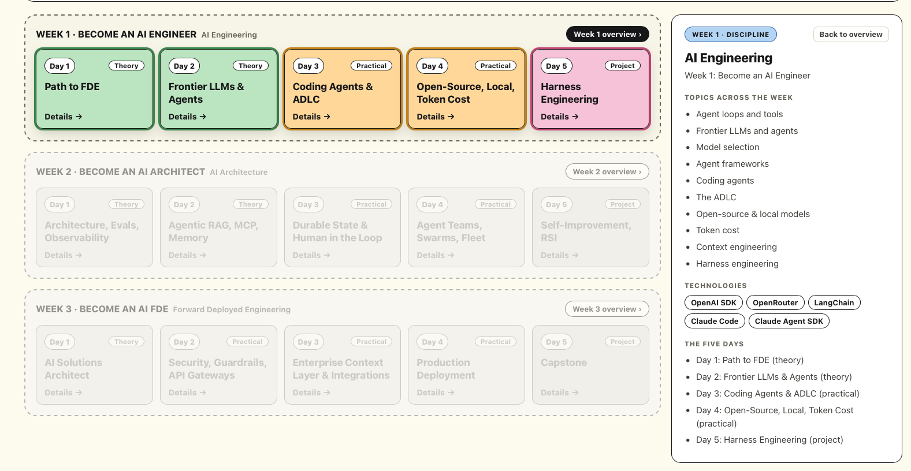

# AI FDE: My Take on the Course

My notes and code from **AI FDE: The Forward Deployed Engineer & Agentic AI Architect**, a 3 week course by **Edward Donner** on becoming an AI Forward Deployed Engineer.

Currently, I am on week 1 and the snapshot will be updated frequently showing the status of this repo.

> This is an unofficial personal repo that documents my learning and my takes on the concepts taught in the course. The course content and the original course code belong to the course author.

## About this repo

The course teaches through Jupyter notebooks. I use this repo to restructure each project from the course as modular Python code (separate modules for config, LLM client, tools and agent logic), for my own learning and practice. The goal is to understand each concept better by rebuilding it in a different shape.

## Course links

- [Course resources page](https://edwarddonner.com/2026/10/14/ai-fde-the-forward-deployed-engineer-agentic-ai-architect/)
- [Course on Udemy](https://www.udemy.com/course/ai-fde-forward-deployed-engineer-agentic-ai-architect/)
- [Course repo (starter code, labs, setup instructions)](https://github.com/ed-donner/undercover)

## Projects

| Folder | Description |
| --- | --- |
| [1-Project_Maze](1-Project_Maze/) | Modular version of the Maze project: `config.py`, `llm_client.py`, `tools.py`, `agent.py`, `main.py` |

## Takeaways

Each concept below gets a plain-English explanation and a pointer to where it lives in my code. More will be added as the course goes on.

### Agent harness (Project Maze)

**In plain English:** An AI model on its own can only write text. A harness is the code around it that lets it act, like giving a smart assistant a phone and a to-do list, and then keeping them going until the job is done

**Where it lives in this project:**
- **The loop:** `run_agent()` in [agent.py](1-Project_Maze/agent.py) calls the model, runs any tool it asks for, returns the result, and repeats until the model gives a final answer.
- **The ability:** `read_web_page` in [tools.py](1-Project_Maze/tools.py) is the one thing the model can ask for, and `handle_tool_call()` carries it out.
- **The rules:** the tool only opens pages inside the maze site, and `max_steps=25` stops the loop from running forever.
- **The goal:** [main.py](1-Project_Maze/main.py) hands over the task to start the loop.

## Credits

All course material and original code by [Edward Donner](https://edwarddonner.com/). Any mistakes in this repo are mine.
